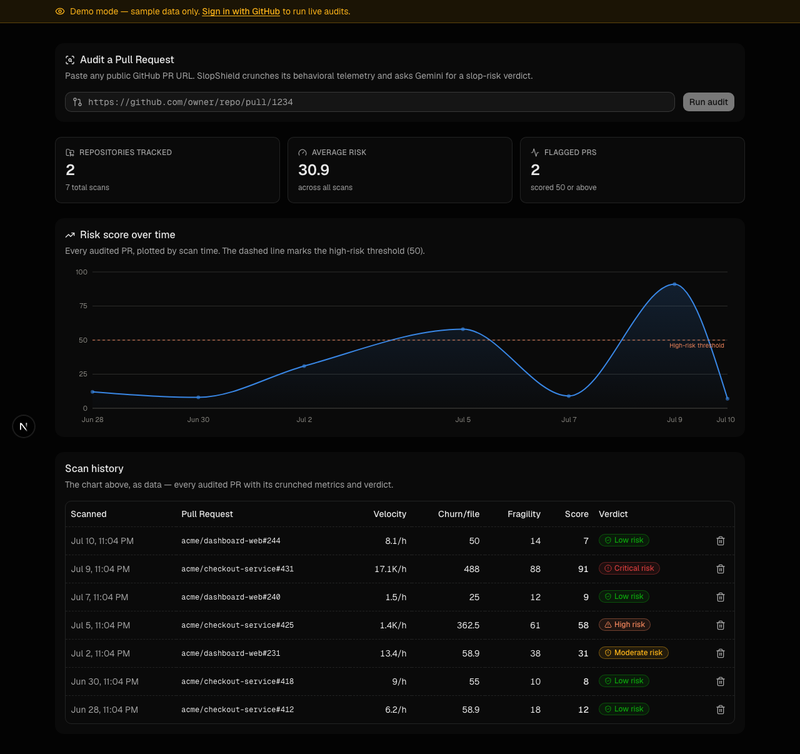
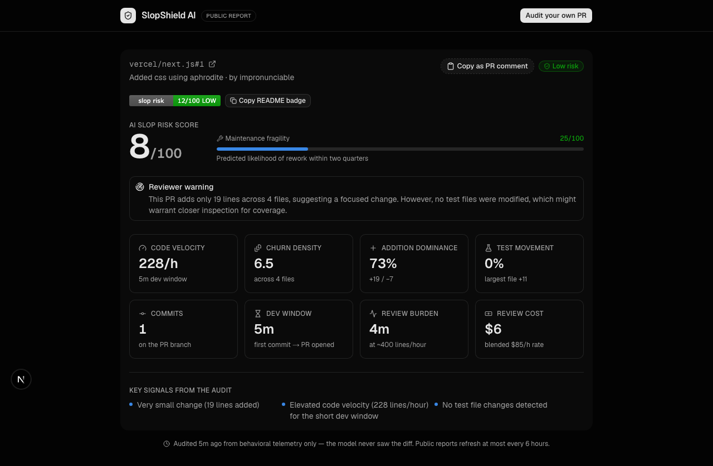

# SlopShield AI

**A telemetry-based "AI slop" risk auditor for GitHub Pull Requests.**



Paste a PR URL. SlopShield pulls its behavioral telemetry from the GitHub API — commit timeline, churn, file mix, test movement — derives a set of engineering-signal metrics, and asks Gemini 2.5 Flash to render a structured risk verdict. The model never sees the diff itself, only the shape of how the change was made. That keeps every audit small, fast, and orthogonal to text-based "AI detector" tools that slop authors already know how to evade.

## Why telemetry, not text

Human engineering leaves a temporal signature: code accretes over hours or days, deletions accompany additions, tests move with source. Low-effort AI-generated PRs tend to arrive as a single monolithic paste — thousands of added lines minutes after the first commit, near-zero deletions, no tests touched. SlopShield quantifies that signature (code velocity, churn density, addition dominance, test-file ratio, largest single-file addition) *before* the AI audit ever runs, then has Gemini reason over the numbers with a strict JSON response schema — never free text to regex-scrape.

## What's in the box

- **PR audit pipeline** — GitHub REST → Metadata Cruncher (`lib/metrics.ts`) → Gemini structured audit (`lib/gemini.ts`) → Supabase, end to end in `app/actions.ts`.
- **Repo Radar** (`/radar`) — paste `owner/repo` and sweep the whole open-PR queue at once: telemetry is crunched per PR, then a *single* Gemini call scores every PR relative to the repo's own baseline (a monorepo of 2k-line PRs reads differently than a library of 80-line patches) and returns a maintainer-facing review order. PRs the model fails to score fall back to a deterministic telemetry heuristic (`heuristicRiskScore`) instead of rendering unscored. Stateless — sweeps never touch your scan history.
- **Unit test suite** — 74 Vitest tests over the pure core: PR-URL/repo-input parsing (SSRF grammar), the Metadata Cruncher (division-by-zero, NaN-date, velocity-floor edges), the fixed-window rate limiter (fake timers), and both Gemini output normalizers (clamping, hallucinated-PR reconciliation). Runs in CI on every push.
- **Auth + per-user history** — GitHub OAuth via Supabase, Postgres RLS scopes every row to its owner.
- **Zero-login demo** (`/demo`) — the full dashboard rendered over representative sample data, no credentials required.
- **Nightly fleet rollup** (`app/api/cron/route.ts`) — aggregates the trailing 30 days into per-repo daily health snapshots, guarded by a constant-time bearer-token check.
- **Public report pages** (`/report/OWNER/REPO/123`) — a shareable, unauthenticated audit report for any public PR. The pipeline result lives in the Next.js data cache for 6 hours, so a link costs GitHub + Gemini once per window no matter how many people open it; failures are never cached. Every page ships Open Graph metadata backed by a generated card image (`/api/og/…`, `next/og`/Satori), so links unfurl with the score in Slack/LinkedIn/Discord:

  

- **Embeddable README badge** (`app/api/badge/[owner]/[repo]/[number]/route.ts`) — a public, unauthenticated SVG endpoint that runs (and caches) the same audit pipeline so anyone can drop a live risk badge into their own repo. The badge clicks through to the PR's public report page, closing the loop: badge → report → "Audit your own PR":

  ```md
  [](https://your-deployment.example/report/OWNER/REPO/123)
  ```

  Cached 6 hours per PR in `badge_scans` (a public-read table, separate from the private per-user `scans` table), with a global + per-IP rate limiter in front of the expensive path so the public endpoint can't be used to burn the GitHub/Gemini quota. The cache is an optimization, not a dependency — a misconfigured service key degrades to audit-per-view, loudly in the logs and invisibly to viewers.

## Stack

Next.js 16 (App Router), Tailwind v4, Supabase (Postgres + Auth + RLS), `@google/genai` (Gemini 2.5 Flash, structured output), Recharts, shadcn/Base UI.

## Security notes

- Every PR URL is parsed with a strict `https://github.com/{owner}/{repo}/pull/{number}` grammar before anything reaches an outbound request (`lib/github.ts`) — no open redirect / SSRF surface.
- Gemini's response schema is defense-in-depth, not the only guard: every field is re-clamped and re-validated server-side before it touches the database or the UI (`normalizeAudit` in `lib/gemini.ts`).
- The service-role Supabase client (`lib/supabase/admin.ts`) is `server-only` and used exclusively by the cron job and the badge route — it never reaches client-bundled code.
- Internal errors are logged server-side only; the client gets either a user-correctable message (bad URL, GitHub rate limit) or a single generic failure notice.
- Both the expensive paths — the authenticated "Run audit" action and the public badge route — are rate-limited (`lib/rate-limit.ts`), and a same-user re-scan of an identical PR within a 10-minute cooldown reuses the prior verdict instead of re-billing GitHub/Gemini.
- Outbound GitHub requests carry a 10s timeout (`AbortSignal.timeout`) so a hung upstream request can't hang the request indefinitely.
- Deleting a scan is scoped twice over: the server action filters by `user_id`, and Postgres RLS (`scans_delete_own`) enforces it independently.

## Setup

1. Create a free [Supabase](https://supabase.com) project, then run `supabase/schema.sql` in its SQL Editor (creates `scans`, `repo_health_snapshots`, and `badge_scans`, all with RLS).
2. Enable the GitHub provider under **Authentication → Providers**, with a GitHub OAuth App pointing its callback at `https://YOUR-PROJECT-REF.supabase.co/auth/v1/callback`.
3. Get a free [Gemini API key](https://aistudio.google.com/apikey).
4. Copy `.env.example` to `.env.local` and fill in every value — Supabase URL/anon key/service-role key, `GEMINI_API_KEY`, an optional `GITHUB_TOKEN` (raises the REST rate limit from 60 to 5000 req/hour), and a `CRON_SECRET` (`openssl rand -hex 32`).

   > **Replace every placeholder.** On new Supabase projects the two keys live
   > under **Project Settings → API keys**: the *publishable* key
   > (`sb_publishable_…`) goes in `NEXT_PUBLIC_SUPABASE_ANON_KEY` and the
   > *secret* key (`sb_secret_…`) goes in `SUPABASE_SERVICE_ROLE_KEY`. A
   > leftover placeholder in the secret key doesn't crash the app — it
   > silently disables badge caching and the cron rollup (the server logs
   > will tell you).
5. `npm install && npm run dev`, then open `http://localhost:3000`.

On Vercel, set the same env vars as Project Settings → Environment Variables; a `CRON_SECRET` variable is auto-attached by Vercel Cron as the bearer token for `/api/cron`.
